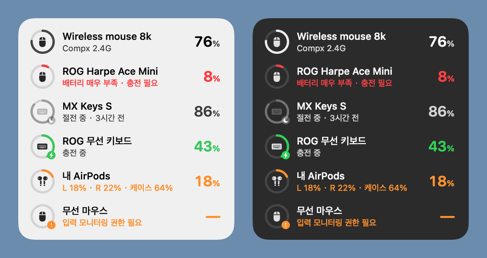

# Device Battery

[English](README.md) | **한국어** | [简体中文](README.zh-CN.md)

무선 마우스, 키보드, 이어폰의 배터리 잔량을 한눈에 보여 주는 가벼운 macOS·Windows 데스크탑 위젯입니다. macOS가 직접 읽지 못하는 2.4GHz 리시버 연결 기기도 지원합니다.



<sub>라이트 / 다크 모드 예시입니다. 실제로는 macOS 글래스 재질 배경이라 바탕화면이 비쳐 보입니다.</sub>

## 주요 기능

- **macOS가 못 읽는 배터리도 표시**: 로지텍 Bolt / Unifying 리시버, ROG Omni 리시버, Compx 칩 4K/8K 마우스 리시버와 직접 통신해 배터리를 읽습니다.
- **블루투스 기기도 함께 표시**: AirPods(왼쪽·오른쪽·케이스를 따로 표시), Magic Keyboard / Mouse / Trackpad, 그리고 배터리 정보를 macOS에 알려 주는 다른 블루투스 기기.
- **기기가 절전 중이어도 잔량 확인**: 마지막으로 읽은 잔량과 시간을 보여 줍니다. 예: 「절전 중 · 3시간 전」.
- **배터리 부족 알림**: 20%와 10%가 되면 한 번씩 시스템 알림을 보냅니다.
- **가벼움**: 네이티브 Swift, 서드파티 의존성 없음. 앱 크기 1MB 미만, 메모리 약 20MB, 평소 CPU 사용률 약 0%.
- **방해하지 않음**: 데스크탑 레이어(일반 윈도우 아래)에 있고, 모든 데스크탑 공간에 표시되며, 포커스를 가져가지 않고, Dock 아이콘도 없습니다.
- **다국어 지원**: English, 한국어, 简体中文. macOS 언어 설정을 따릅니다.

## 지원 기기

| 연결 방식 | 예시 | 읽는 방식 |
| --- | --- | --- |
| 로지텍 Logi Bolt / Unifying 및 기타 로지텍 리시버 | MX Keys, MX Master, G 시리즈 | HID++ 2.0 (Logi Options+와 같은 프로토콜) |
| ROG Omni 리시버 | ROG 마우스, ROG 키보드 | ROG 제조사 명령 |
| Compx 칩 2.4GHz 리시버 | ATK, VXE 등 4K/8K 무선 마우스 | Compx 제조사 명령 |
| 블루투스 | AirPods, Magic Keyboard / Mouse / Trackpad 등 | macOS가 이미 가진 배터리 정보 |

위젯은 「배터리 상태 조회」 같은 읽기 명령만 보내며, 기기 설정은 절대 바꾸지 않습니다.

## macOS 설치 (3단계)

macOS 14 이상이 필요합니다. 아직 미리 빌드된 설치 파일은 없으므로, 자신의 Mac에서 한 번 빌드해야 합니다. 직접 빌드한 앱은 Gatekeeper에 막히지 않아 더블 클릭으로 바로 열립니다.

**1단계: 빌드 도구 설치**

**터미널**을 열고(Launchpad → 기타 → 터미널) 아래 한 줄을 붙여 넣고 Return 키를 누른 뒤, 나타나는 창에서 **설치**를 클릭하세요.

```bash
xcode-select --install
```

이미 설치되어 있다고 나오면 다음 단계로 넘어가면 됩니다. 빌드에는 Swift 6.2 이상(Xcode 26 또는 Command Line Tools 26 이상)이 필요하며, `swift --version`으로 확인할 수 있습니다.

**2단계: 소스 코드 받기**

```bash
git clone https://github.com/lizhuoh9/DeviceBattery.git
cd DeviceBattery
```

이 페이지의 초록색 **Code → Download ZIP** 버튼으로 받아 압축을 푼 뒤, 터미널에서 그 폴더로 `cd` 해도 됩니다.

**3단계: 빌드 및 설치**

```bash
./scripts/install.sh
```

첫 빌드는 1분 정도 걸립니다. 완료되면 앱이 「응용 프로그램」 폴더에 복사되고 자동으로 실행되며, 위젯이 화면 오른쪽 위에 나타납니다.

## macOS에서 처음 사용할 때

1. **로그인 시 자동 실행**: 위젯을 오른쪽 클릭하고 **로그인 시 열기**를 켜세요.
2. **입력 모니터링 권한** (Compx 마우스 리시버를 쓸 때만 필요):
   - macOS가 권한을 묻는 창을 띄웁니다. **시스템 설정 열기**를 클릭하고 **개인정보 보호 및 보안 → 입력 모니터링**에서 **Device Battery**를 켜세요.
   - **종료 후 다시 열기**가 나오면 클릭하세요.
   - 이런 리시버를 열려면 macOS가 이 권한을 요구합니다. 위젯은 키 입력을 전혀 읽지 않습니다.
3. **알림 권한**: 기기 배터리가 처음 부족해질 때 macOS가 알림 허용 여부를 묻습니다. 허용해야 배터리 부족 알림을 받을 수 있습니다.

## Windows (베타)

같은 리시버를 지원하는 Windows 버전이 [`windows/`](windows/) 폴더에 있습니다. 약 1MB짜리 `DeviceBattery.exe` 파일 하나이며, 설치나 별도 런타임이 필요 없습니다.

> **베타 버전**입니다. Windows에서 자동 빌드와 테스트를 거쳤지만, 실제 리시버로는 아직 확인하지 못했습니다. 잘 되는 점과 안 되는 점을 [Issue](https://github.com/lizhuoh9/DeviceBattery/issues)로 알려 주세요.

1. [Releases](https://github.com/lizhuoh9/DeviceBattery/releases)에서 `DeviceBattery.exe`를 내려받아 원하는 폴더(예: 문서)에 두세요.
2. 더블 클릭해 실행합니다. 코드 서명이 없어서 SmartScreen이 「Windows의 PC 보호」를 띄울 수 있습니다. **추가 정보 → 실행**을 누르세요(처음 한 번만).
3. 화면 오른쪽 위에 위젯이, 알림 영역에 아이콘이 나타납니다. 둘 중 하나를 오른쪽 클릭해 메뉴에서 **Windows 시작 시 실행**을 켜세요.

macOS 버전과 다른 점:

- 권한 요청이 없습니다. Windows에서는 위젯이 리시버를 바로 읽을 수 있습니다.
- 블루투스 기기는 Windows가 알려 주는 잔량 하나만 표시합니다(이어버드와 케이스를 따로 표시하지 않음).
- 위젯은 다른 창 뒤에 있습니다. 트레이 아이콘을 클릭하면 보이거나 숨겨집니다.
- 기기가 안 보이면 오른쪽 클릭 → **기기 진단 보고서…** 를 열어 텍스트 파일을 Issue에 첨부해 주세요.

직접 빌드하려면 [Rust](https://rustup.rs)를 설치한 뒤 `windows` 폴더에서 `cargo build --release`를 실행하세요.

## 사용 방법

| 동작 | 기능 |
| --- | --- |
| 위젯 드래그 | 위치 이동 (위치는 기억됩니다) |
| 위젯 클릭 | 지금 바로 새로고침 |
| 위젯 오른쪽 클릭 | 기기 이름 변경·숨기기, 다른 윈도우 위에 유지, 배터리 부족 알림, 로그인 시 열기, 종료 |

화면 보는 법:

- **원형 게이지**가 잔량을 나타냅니다. 정상일 때는 무채색, 20% 이하는 주황색, 10% 이하는 빨간색, 충전 중에는 초록색입니다.
- **게이지 오른쪽 아래의 작은 아이콘**: ⚡ 충전 중, 🌙 절전 중(표시되는 잔량은 마지막으로 읽은 값), ❗ 권한 필요(해당 줄을 클릭하면 설정이 바로 열립니다).
- 위젯이 보일 때는 1분마다, 윈도우에 가려져 있을 때는 5분마다 새로고침합니다. 리시버를 꽂거나 뺄 때, 로지텍 리시버가 기기 연결을 알릴 때, Mac이 잠자기에서 깨어날 때는 즉시 새로고침합니다.

## 자주 묻는 질문

**기기가 계속 「절전 중」으로 표시돼요.**
기기가 절전 중이거나 꺼져 있거나, 다른 곳에 연결되어 있는 경우입니다(예: 로지텍 키보드를 Easy-Switch로 다른 컴퓨터에 전환한 경우). 키를 누르거나 마우스를 움직여 깨운 뒤 위젯을 클릭해 새로고침하세요.

**마우스 줄에 계속 「입력 모니터링 권한 필요」가 떠요.**
**시스템 설정 → 개인정보 보호 및 보안 → 입력 모니터링**에서 Device Battery를 켠 다음, 위젯을 오른쪽 클릭 → **Device Battery 종료** 후 앱을 다시 여세요.

**다시 설치하거나 업데이트한 뒤 마우스가 또 권한을 요구해요.**
빌드할 때마다 앱 서명이 바뀌어 macOS가 새 앱으로 인식합니다. **입력 모니터링**에서 Device Battery를 선택하고 목록 아래의 **−** 버튼으로 이전 항목을 삭제한 뒤, 앱을 열어 안내에 따라 다시 허용하세요. 이전 항목의 스위치를 다시 켜는 것만으로는 적용되지 않습니다.

**제 기기가 보이지 않아요.**
현재는 위 표의 리시버만 지원합니다. 블루투스 기기는 macOS가 배터리 정보를 알고 있을 때만 표시됩니다(**시스템 설정 → Bluetooth**에서 잔량이 보이는 기기). 다른 기기 지원을 원하시면 터미널에서 `hidutil list`를 실행한 결과를 첨부해 Issue를 남겨 주세요.

**위젯 언어는 어떻게 바꾸나요?**
macOS 언어 설정을 따릅니다. 이 앱만 바꾸려면 **시스템 설정 → 일반 → 언어 및 지역 → 응용 프로그램**에서 **+**를 눌러 Device Battery와 언어를 선택한 뒤, 앱을 종료했다가 다시 여세요.

**위젯이 윈도우에 가려져요.**
위젯은 원래 데스크탑 레이어에 있습니다. 「데스크탑 보기」 제스처를 쓰거나, 오른쪽 클릭 후 **다른 윈도우 위에 유지**를 켜세요.

**설치 스크립트가 Swift를 찾을 수 없다고 해요.**
먼저 1단계 `xcode-select --install`을 진행하세요.

## 업데이트

```bash
cd DeviceBattery
git pull
./scripts/install.sh
```

업데이트 후 마우스가 권한을 요구하면 위의 「다시 설치하거나 업데이트한 뒤」 항목을 참고하세요.

## 삭제

1. 위젯을 오른쪽 클릭 → **Device Battery 종료**.
2. 「응용 프로그램」 폴더에서 Device Battery를 삭제합니다.
3. 설정도 지우려면(선택):

   ```bash
   defaults delete local.DeviceBattery
   ```

4. 시스템 설정의 **로그인 항목**과 **입력 모니터링**에서 Device Battery를 삭제합니다(추가했던 경우).

## 개인정보

- 네트워크에 연결하지 않으며, 어떤 데이터도 수집하지 않습니다.
- 리시버에는 배터리 상태 조회 명령만 보냅니다.
- 시스템 로그에서 기기 이름은 비공개로 처리됩니다.

## 개발

```bash
./scripts/test.sh                      # 단위 테스트 (Swift Testing)
./scripts/build-app.sh                 # 설치 없이 Device Battery.app만 빌드
.build/release/DeviceBattery --render-preview out.png --language ko   # 예시 데이터로 미리 보기 렌더링 (en / ko / zh-Hans)
```

```
Sources/BatteryCore/     프로토콜과 상태 로직 (순수 Swift, 단위 테스트 포함)
  Logitech/              HID++ 프레임, 배터리 해석, 리시버 페어링 레지스터, 리더
  Asus/                  ROG Omni 리시버
  Compx/                 Compx 2.4GHz 리시버
  Bluetooth/             system_profiler / IOKit 파싱
  Store/                 읽은 값 병합, 절전 중인 기기의 마지막 잔량 유지, 표시 문구
  Alerts/                배터리 부족 알림 정책
  Localization/          영어 / 한국어 / 중국어 문구
Sources/DeviceBattery/   AppKit 위젯과 IOKit 연결 계층
Tests/BatteryCoreTests/  단위 테스트
scripts/                 설치, 빌드, 테스트, 아이콘 생성
windows/                 Windows 버전 (Rust, 프로토콜 로직은 같고 단위 테스트 포함)
```

## 감사의 말

각 리시버의 프로토콜은 다음 오픈 소스 프로젝트를 참고했습니다(코드는 복사하지 않았습니다).

- 로지텍 HID++: [Solaar](https://github.com/pwr-Solaar/Solaar)
- ROG: [G-Helper](https://github.com/seerge/g-helper), [rogctl](https://github.com/Humblemonk/rogctl), [battery-tray](https://github.com/mikgangal/battery-tray)
- Compx: [mouse-battery-reminder](https://github.com/245582001g-oss/mouse-battery-reminder)

## 라이선스

[MIT](LICENSE) © 2026 Zhuoheng Li
