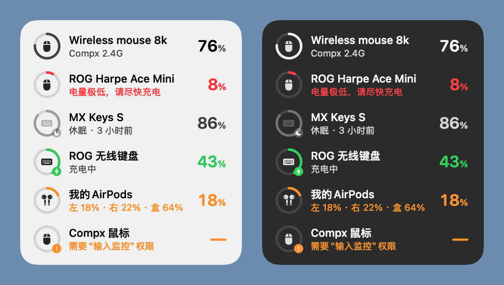

# Device Battery

一个轻量的 macOS 桌面挂件，一眼看到无线鼠标、键盘、耳机的电量。

*A lightweight macOS desktop widget that shows the battery of your wireless mice, keyboards and headphones — including 2.4 GHz receivers (Logitech Bolt/Unifying, ROG Omni, Compx 8K dongles) that macOS itself cannot read.*



<sub>示意图：浅色 / 深色外观。实际使用时背景是 macOS 的玻璃材质，会透出桌面壁纸。</sub>

## 它能做什么

- **读出 macOS 读不到的电量**：罗技 Bolt / Unifying 接收器、ROG Omni 接收器、Compx 芯片的 4K/8K 鼠标接收器，直接和接收器通信读取电量。
- **蓝牙设备也一起显示**：AirPods（左耳、右耳、充电盒分开显示）、妙控键盘 / 鼠标 / 触控板，以及其他向 macOS 报告电量的蓝牙设备。
- **设备休眠也知道电量**：显示最后一次读到的电量和时间，例如「休眠 · 3 小时前」。
- **低电量提醒**：电量降到 20% 和 10% 时各发一次系统通知。
- **足够轻**：原生 Swift，无第三方依赖。App 不到 1 MB，常驻内存约 20 MB，平时 CPU 占用约 0%。
- **不打扰**：挂件待在桌面层（普通窗口下面），所有桌面空间都显示，不抢焦点，没有 Dock 图标。

## 支持的设备

| 连接方式 | 设备举例 | 读取方式 |
| --- | --- | --- |
| 罗技 Logi Bolt / Unifying 及其他罗技接收器 | MX Keys、MX Master、G 系列 | HID++ 2.0（与 Logi Options+ 相同的协议） |
| ROG Omni 接收器 | ROG 鼠标、ROG 键盘 | ROG 厂商指令 |
| Compx 芯片 2.4G 接收器 | ATK、VXE 等 4K/8K 无线鼠标 | Compx 厂商指令 |
| 蓝牙 | AirPods、妙控键盘 / 鼠标 / 触控板等 | macOS 自带的电量信息 |

挂件只向设备发送「查询电量」一类的读取指令，不会修改任何设备设置。

## 安装（3 步）

需要 macOS 14 或更新版本。目前没有现成的安装包，需要在自己的 Mac 上编译一次。编译出来的 App 不会被 macOS 拦截，双击就能打开。

**第 1 步：安装编译工具**

打开「终端」（启动台 → 其他 → 终端），粘贴下面这行并回车，然后在弹出的窗口里点「安装」：

```bash
xcode-select --install
```

如果提示已经安装过，直接进行下一步。编译需要 Swift 6.2 或更新的版本（Xcode 26 或 Command Line Tools 26 起），可以用 `swift --version` 查看。

**第 2 步：下载源码**

```bash
git clone https://github.com/lizhuoh9/DeviceBattery.git
cd DeviceBattery
```

也可以在本页点击绿色的 **Code → Download ZIP**，解压后在终端里 `cd` 进解压出来的文件夹。

**第 3 步：编译并安装**

```bash
./scripts/install.sh
```

第一次编译大约需要 1 分钟。完成后 App 会被装到「应用程序」文件夹并自动启动，挂件出现在屏幕右上角。

## 第一次使用

1. **开机自启**：右键挂件，勾选「登录时打开」。
2. **输入监控权限**（只有 Compx 鼠标接收器需要，其他设备不需要）：
   - 系统会弹窗询问。点「打开系统设置」，在「隐私与安全性 → 输入监控」里打开 **Device Battery**。
   - 如果系统提示「退出并重新打开」，点它。
   - 这是 macOS 打开这类接收器时的要求，挂件不会读取你的任何按键。
3. **通知权限**：第一次有设备电量低时，系统会问是否允许通知，允许后才能收到低电量提醒。

## 日常使用

| 操作 | 作用 |
| --- | --- |
| 拖动挂件 | 移动位置，会被记住 |
| 单击挂件 | 立即刷新电量 |
| 右键挂件 | 重命名或隐藏设备、置于其他窗口之上、低电量提醒、登录时打开、退出 |

怎么看状态：

- **圆环**表示电量。正常时是中性色，≤20% 变橙色，≤10% 变红色，充电时变绿色。
- **圆环右下角的小图标**：⚡ 充电中，🌙 休眠中（显示的是最后一次读到的电量），❗ 需要授权（单击这一行可以直接打开设置）。
- 挂件可见时每分钟刷新一次，被窗口挡住时每 5 分钟刷新一次。插拔接收器、罗技接收器报告设备连接、Mac 从睡眠中唤醒时会立即刷新。

## 常见问题

**设备一直显示「休眠」？**
设备在休眠、关机，或者切换到了别的连接（比如罗技键盘的 Easy-Switch 切到了另一台电脑）。按一下按键或动一下鼠标唤醒，再单击挂件刷新即可。

**鼠标那一行一直提示「需要“输入监控”权限」？**
到「系统设置 → 隐私与安全性 → 输入监控」打开 Device Battery，然后右键挂件「退出」，再重新打开 App。

**重新安装或更新后，鼠标又提示需要权限？**
每次重新编译，App 的签名都会变，macOS 会把它当成新 App。在「输入监控」里选中 Device Battery，点下方的「−」删掉旧条目，再打开 App 按提示重新授权。只把旧条目的开关重新打开是没用的。

**我的设备没有出现？**
目前只支持上面表格里的接收器。蓝牙设备要 macOS 自己能拿到电量才会显示（在「系统设置 → 蓝牙」里能看到电量的设备）。如果想支持别的设备，欢迎提 Issue，附上终端命令 `hidutil list` 的输出。

**挂件被窗口挡住了？**
挂件默认待在桌面层。可以用「显示桌面」手势查看，也可以右键勾选「置于其他窗口之上」。

**安装脚本提示找不到 Swift？**
先完成第 1 步 `xcode-select --install`。

## 更新

```bash
cd DeviceBattery
git pull
./scripts/install.sh
```

更新后如果鼠标提示需要权限，按上面「重新安装或更新后」那一条处理。

## 卸载

1. 右键挂件 → 退出。
2. 删除「应用程序」里的 Device Battery。
3. 清除设置（可选）：

   ```bash
   defaults delete local.DeviceBattery
   ```

4. 在「系统设置」的「登录项」和「输入监控」里删除 Device Battery（如果之前添加过）。

## 隐私

- 不联网，不收集任何数据。
- 只向接收器发送查询电量的指令。
- 系统日志中的设备名称做了隐私处理。

## 开发

```bash
./scripts/test.sh                                # 单元测试（Swift Testing）
./scripts/build-app.sh                           # 只编译，生成 Device Battery.app，不安装
.build/release/DeviceBattery --render-preview out.png   # 用示例数据渲染界面预览图
```

```
Sources/BatteryCore/     协议与状态逻辑（纯 Swift，有单元测试）
  Logitech/              HID++ 帧、电池解码、接收器配对寄存器、读取器
  Asus/                  ROG Omni 接收器
  Compx/                 Compx 2.4G 接收器
  Bluetooth/             system_profiler / IOKit 解析
  Store/                 合并读数、保留休眠设备的最后电量、显示文案
  Alerts/                低电量提醒策略
Sources/DeviceBattery/   AppKit 挂件与 IOKit 连接层
Tests/BatteryCoreTests/  单元测试
scripts/                 安装、编译、测试、图标生成
```

## 致谢

各接收器的协议细节参考了这些开源项目：

- 罗技 HID++：[Solaar](https://github.com/pwr-Solaar/Solaar)
- ROG：[G-Helper](https://github.com/seerge/g-helper)、[rogctl](https://github.com/Humblemonk/rogctl)、[battery-tray](https://github.com/mikgangal/battery-tray)
- Compx：[mouse-battery-reminder](https://github.com/245582001g-oss/mouse-battery-reminder)
