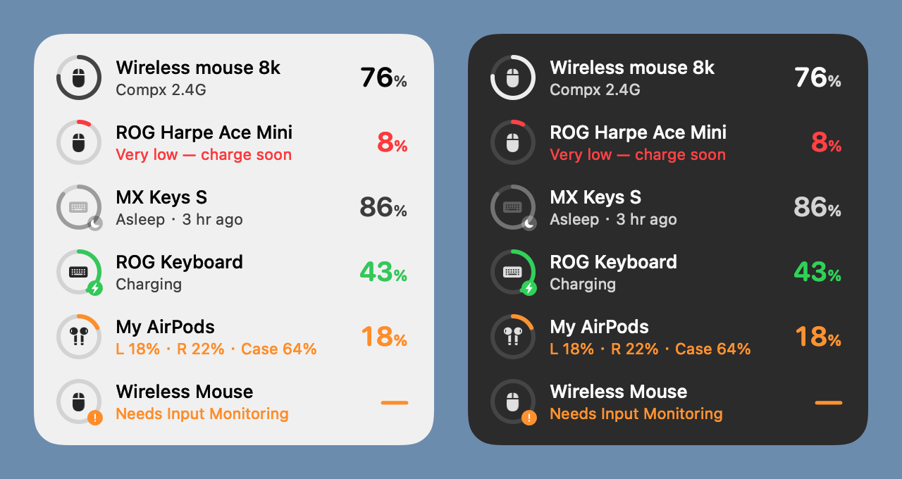

# Device Battery

**English** | [한국어](README.ko.md) | [简体中文](README.zh-CN.md)

A lightweight desktop widget for macOS and Windows that shows, at a glance, the battery of your wireless mice, keyboards and headphones — including 2.4 GHz receivers that macOS itself cannot read.



<sub>Light and dark appearance. On your Mac the background is macOS glass, so your wallpaper shows through.</sub>

## Features

- **Reads batteries macOS can't**: talks directly to Logitech Bolt / Unifying receivers, the ROG Omni receiver and Compx-chip 4K/8K mouse dongles.
- **Bluetooth devices too**: AirPods (left, right and case shown separately), Magic Keyboard / Mouse / Trackpad, and any other Bluetooth device that reports its battery to macOS.
- **Knows the level even when a device sleeps**: shows the last level read and when, e.g. "Asleep · 3 hr ago".
- **Low battery alerts**: one notification at 20% and another at 10%.
- **Light**: native Swift, no third-party dependencies. The app is under 1 MB, uses about 20 MB of memory and ~0% CPU when idle.
- **Unobtrusive**: sits on the desktop layer (below your windows), shows on every Space, never steals focus, no Dock icon.
- **Speaks your language**: English, 한국어 and 简体中文, following your macOS language.

## Supported devices

| Connection | Examples | How it reads the battery |
| --- | --- | --- |
| Logitech Logi Bolt / Unifying and other Logitech receivers | MX Keys, MX Master, G series | HID++ 2.0 (the protocol Logi Options+ uses) |
| ROG Omni receiver | ROG mice and keyboards | ROG vendor commands |
| Compx-chip 2.4 GHz receivers | ATK, VXE and other 4K/8K wireless mice | Compx vendor commands |
| Bluetooth | AirPods, Magic Keyboard / Mouse / Trackpad, … | Battery information macOS already has |

The widget only sends read-only "battery status" queries and never changes any device setting.

## Install on macOS (3 steps)

Requires macOS 14 or later. There is no prebuilt download yet: you build the app once on your own Mac. An app built on your Mac is not blocked by Gatekeeper, so it opens with a double-click.

**Step 1: install the build tools**

Open **Terminal** (Launchpad → Other → Terminal), paste this line and press Return, then click **Install** in the window that appears:

```bash
xcode-select --install
```

If it says the tools are already installed, go to the next step. Building needs Swift 6.2 or later (Xcode 26 or Command Line Tools 26 and newer); `swift --version` shows yours.

**Step 2: download the source**

```bash
git clone https://github.com/lizhuoh9/DeviceBattery.git
cd DeviceBattery
```

Or click the green **Code → Download ZIP** button on this page, unzip it, and `cd` into the unzipped folder in Terminal.

**Step 3: build and install**

```bash
./scripts/install.sh
```

The first build takes about a minute. The app is then copied to your Applications folder and started; the widget appears in the top-right corner of your screen.

## First launch on macOS

1. **Start at login**: right-click the widget and turn on **Open at Login**.
2. **Input Monitoring** (only needed for Compx mouse dongles):
   - macOS shows a prompt. Click **Open System Settings** and, under **Privacy & Security → Input Monitoring**, turn on **Device Battery**.
   - If macOS offers **Quit & Reopen**, click it.
   - macOS requires this permission to open this kind of receiver. The widget never reads your keystrokes.
3. **Notifications**: the first time a device runs low, macOS asks whether Device Battery may send notifications. Allow it to get low battery alerts.

## Windows (beta)

A Windows version with the same receiver support lives in [`windows/`](windows/): a single `DeviceBattery.exe` of about 1 MB, with no installer and no runtime to install.

> **Beta.** It is built and tested automatically on Windows, but has not yet been checked against real receivers. Please [open an issue](https://github.com/lizhuoh9/DeviceBattery/issues) to report what works and what doesn't.

1. Download `DeviceBattery.exe` from [Releases](https://github.com/lizhuoh9/DeviceBattery/releases) and keep it in a folder of your choice (e.g. Documents).
2. Double-click it. The exe is not code-signed, so SmartScreen may say "Windows protected your PC": click **More info → Run anyway** (first time only).
3. The widget appears in the top-right corner, plus an icon in the notification area. Right-click either one for the menu, and turn on **Start with Windows** there.

Differences from macOS:

- No permission prompts: Windows lets the widget read the receivers directly.
- Bluetooth devices show the single level Windows reports (no separate earbud and case levels). A device that is paired but not connected stays in the list as **Asleep**, with the last level Windows kept for it.
- The widget sits behind your windows; click the tray icon to show or hide it.
- Missing a device? Right-click → **Device Report…** and attach the text file to an issue.

To build it yourself, install [Rust](https://rustup.rs) and run `cargo build --release` in the `windows` folder.

## Everyday use

| Action | What it does |
| --- | --- |
| Drag the widget | Moves it; the position is remembered |
| Click the widget | Refreshes all batteries now |
| Right-click the widget | Rename or hide a device, keep above other windows, low battery alerts, open at login, quit |

Reading the widget:

- The **ring** shows the level. Neutral when healthy, orange at 20% or less, red at 10% or less, green while charging.
- The **small badge** on the ring: ⚡ charging, 🌙 asleep (the level shown is the last one read), ❗ needs permission (click the row to open the settings).
- The widget refreshes every minute while visible and every 5 minutes while covered by windows. Plugging in a receiver, a Logitech receiver reporting a device connection, and waking your Mac trigger an immediate refresh.

## FAQ

**A device always shows "Asleep".**
It is sleeping, switched off, or connected elsewhere (for example, a Logitech keyboard switched to another computer with Easy-Switch). Press a key or move the mouse to wake it, then click the widget to refresh.

**The mouse row keeps saying "Needs Input Monitoring".**
Turn on Device Battery under **System Settings → Privacy & Security → Input Monitoring**, then right-click the widget → **Quit Device Battery** and open the app again.

**After reinstalling or updating, the mouse needs permission again.**
Every build has a new signature, so macOS treats it as a new app. Under **Input Monitoring**, select Device Battery, click **−** below the list to remove the old entry, then open the app and allow it again. Switching the old entry back on has no effect.

**My device doesn't show up.**
Only the receivers in the table above are supported. Bluetooth devices appear only if macOS itself knows their battery (you can see it in **System Settings → Bluetooth**). To ask for another device, open an issue and include the output of `hidutil list` from Terminal.

**How do I change the widget's language?**
It follows your macOS language. To change it for this app only: **System Settings → General → Language & Region → Applications**, click **+**, choose Device Battery and a language, then quit and reopen the app.

**The widget is hidden behind my windows.**
It lives on the desktop layer by design. Use the "Show Desktop" gesture, or right-click and turn on **Keep Above Other Windows**.

**The install script says Swift was not found.**
Do Step 1 first: `xcode-select --install`.

## Update

```bash
cd DeviceBattery
git pull
./scripts/install.sh
```

If the mouse asks for permission afterwards, see "After reinstalling or updating" above.

## Uninstall

1. Right-click the widget → **Quit Device Battery**.
2. Delete Device Battery from your Applications folder.
3. Optionally clear its settings:

   ```bash
   defaults delete local.DeviceBattery
   ```

4. Remove Device Battery from **Login Items** and **Input Monitoring** in System Settings, if you added it there.

## Privacy

- No network access, no data collection.
- Only battery status queries are sent to the receivers.
- Device names are kept private in the system log.

## Development

```bash
./scripts/test.sh                      # unit tests (Swift Testing)
./scripts/build-app.sh                 # build Device Battery.app without installing it
.build/release/DeviceBattery --render-preview out.png --language en   # render a preview with sample devices (en / ko / zh-Hans)
```

```
Sources/BatteryCore/     protocol and state logic (pure Swift, unit-tested)
  Logitech/              HID++ framing, battery decoding, receiver pairing registers, reader
  Asus/                  ROG Omni receiver
  Compx/                 Compx 2.4 GHz receivers
  Bluetooth/             system_profiler / IOKit parsing
  Store/                 merges readings, keeps sleeping devices' last level, display text
  Alerts/                low battery alert policy
  Localization/          English / Korean / Chinese text
Sources/DeviceBattery/   AppKit widget and IOKit glue
Tests/BatteryCoreTests/  unit tests
scripts/                 install, build, test, icon generation
windows/                 the Windows version (Rust; shares the protocol logic, unit-tested)
```

## Acknowledgements

Protocol details were learned from these open-source projects (no code was copied):

- Logitech HID++: [Solaar](https://github.com/pwr-Solaar/Solaar)
- ROG: [G-Helper](https://github.com/seerge/g-helper), [rogctl](https://github.com/Humblemonk/rogctl), [battery-tray](https://github.com/mikgangal/battery-tray)
- Compx: [mouse-battery-reminder](https://github.com/245582001g-oss/mouse-battery-reminder)

## License

[MIT](LICENSE) © 2026 Zhuoheng Li
